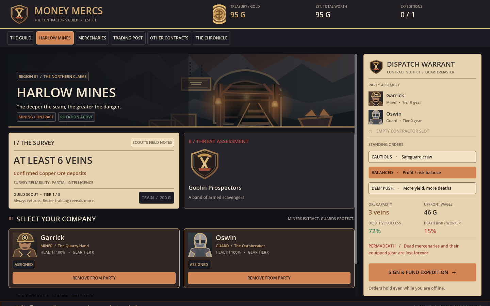

# Money Mercs

**Version 0.4 — Guild Ledger UI**

Money Mercs is a Godot 4.5.1 fantasy mercenary-company and gold-economy management game. Its first interactive vertical slice is **Harlow Mines**.

> *Build a fortune. Let someone else risk their life.*

## Play

1. Pull `main` or clone https://github.com/wiings3/Money-Mercs
2. Import `project.godot` in Godot **4.5.1**. Run with **F5**.
3. Visit **Mercenaries** and hire Garrick (Miner) and ideally Oswin (Guard).
4. Open **Harlow Mines**. Send the guild scout, who returns in about 60 seconds.
5. Read the current rotation's findings, select miners/guards, choose standing orders, then fund the expedition.
6. Gathered ore enters inventory, while mercenaries can be injured or permanently die and lose their gear. View outcomes in **The Chronicle**; sell resources on the **Trading Post** prototype page.

## What's new in 0.4

**All on-screen UI was rebuilt**, replacing the previous dark-green admin-style interface. The native Godot layout uses a warm copper, charcoal, leather and parchment guild theme with original SVG illustrations.

- **Harlow dossier:** panoramic mine art, survey report, enemy portrait and readable recruitment/selection cards.
- **Dispatch warrant:** selected crew, risk estimates, extraction capacity, mission cost and standing orders on a persistent action panel.
- **Scouting:** a separate immortal scout; training speeds surveys and improves intelligence.
- **Rotations:** Harlow ore, threats and hazards change every four hours in this testing build; ore is finite within each rotation.
- **Mining and guarding:** miners establish extraction capacity, guards improve odds and reduce casualties.
- **Consequences:** role-dependent success, injuries and permanent death with gear loss.
- **Reworked screens:** Guild office, Mercenaries, Trading Post (NPC exchange), Other Contracts (legacy systems), and Chronicle.
- **Offline results and existing saves:** the underlying `scripts/game_state.gd` economy remains the source of truth.



**Note:** That preview is automatically rendered from the actual Godot scene during graphical CI. The interface is still intended to evolve through real playtesting; visual automated checks do not prove flawless interaction.

## Controls

Use the top tab bar or keyboard shortcuts **1–6** for Guild, Harlow, Mercenaries, Trading Post, Other Contracts and Chronicle.

Actions save automatically to `user://money_mercs_save.json`. Developer builds expose time skipping and a two-step company reset through The Chronicle.

## Design and roadmap

The full agreed design is in [docs/GAME_DESIGN_DOCUMENT.md](docs/GAME_DESIGN_DOCUMENT.md).

**Long-term goal:** gold remains the principal currency. Physical coin bags and treasury chests, distinctive item modifiers, crafting, realistic simulated company economies and eventually a server-authoritative player trading post are planned but **not implemented in v0.4**.

Other Contracts still use the original simplified expedition simulation. Harlow Mines is the testbed for the new mechanics, and exact risk and progression values are placeholders awaiting playtesting.

## Quality gates

GitHub Actions validates Godot import, boot, core economic simulation, navigation and interactions, Harlow scouting and dispatch. A separate graphical Xvfb workflow renders `docs/ui_harlow_preview.png` whenever the new UI or artwork changes. Layout should be inspected again at different resolutions and during longer play sessions.

**Supported target:** Desktop, 1440×900 initial window, resizable. The old UI scripts have been retired; the root scene now loads `scripts/ledger_ui.gd`.

## Files

```text
scenes/main.tscn
scripts/ledger_ui.gd         Guild Ledger screens + presentation
scripts/game_state.gd        Current gameplay, economy, persistence
assets/ui/                   Original SVG illustrations and portraits
docs/GAME_DESIGN_DOCUMENT.md Living design reference
docs/ui_harlow_preview.png   Visual regression reference
tests/                       CI smoke and visual capture
```
